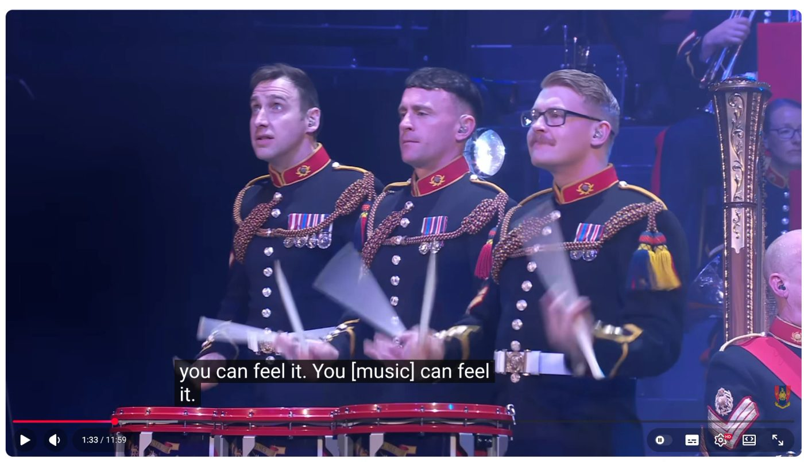

Tối hôm qua mình vào YouTube vì muốn post thử video. Tự nhiên thấy video "[Ibiza Prom Classics, The Bands of HM Royal Marines](https://www.youtube.com/watch?v=qYgn5LxKCFw)", thấy hơi mâu thuẫn, thế là nhảy vào coi.

Kết quả là coi cả buổi tối.

Giữa bài *Rhythm Is a Dancer*, ba ông lính thủy đánh trống, *you can feel it*.

Thời trẻ toàn lo đi học, chả đi clubbing mấy. Mấy đứa bạn rủ đi tối thứ sáu, nhảy cà tưng độ đến 2 giờ sáng là chán, về nhà chơi game quách. Rồi lấy vợ đẻ con. Rồi nhiều thứ khác. Khi đi tập gym giữa buổi làm có nghe nhạc dance club mà không để ý. Sau này về VN chơi thì cũng không thấy ai rủ đi clubbing.

Có hôm ăn nhậu tới hơn 11 giờ đêm, có đứa đòi đi District K, book không được bàn, thế là lại về nhà ngủ tiếp.

Sài Gòn có club nào dành cho người đứng tuổi không ta? Hỏi chơi vậy thôi chứ chả biết thế nào.

Nhưng hôm qua thì đúng là Insomnia, by Faithless.
