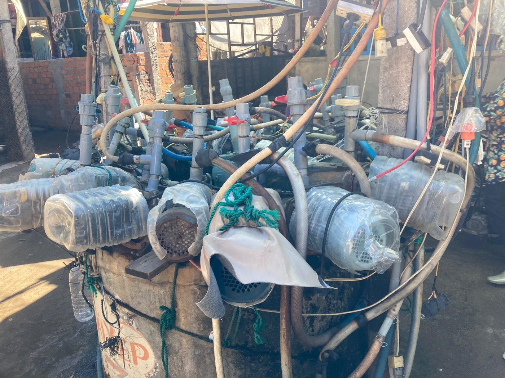
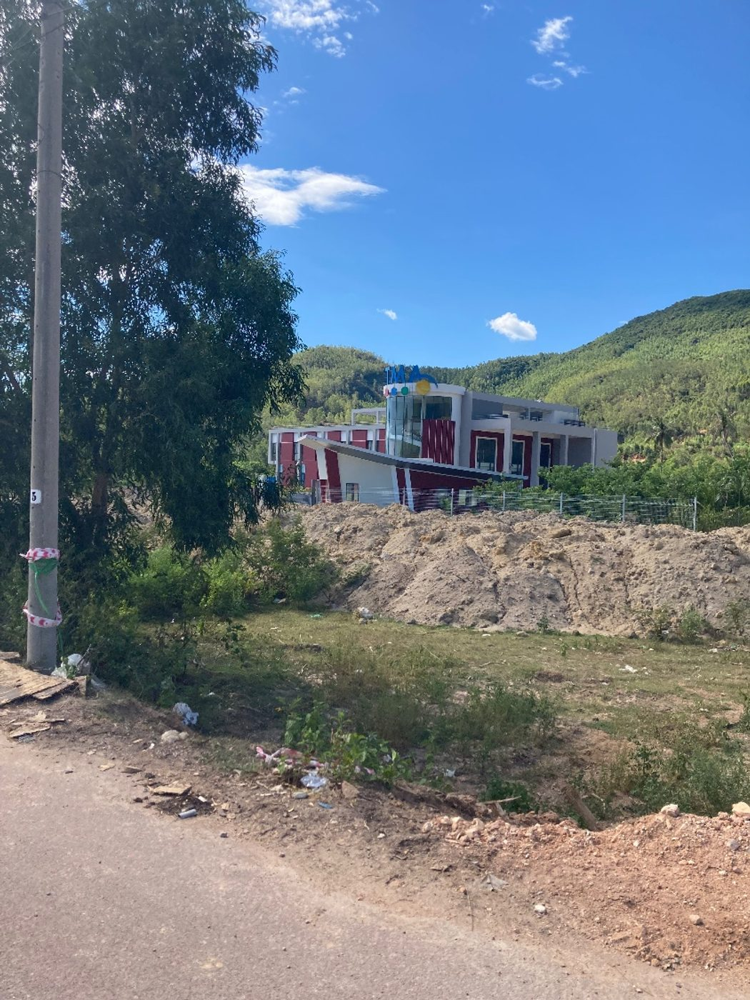

_Quy Nhơn, summer 2023._

Back in the 20th century, we talked about the 21st century as something grand. Communal wells would be long forgotten.

Here we are, 2023. The communal well is still there. The inefficiency is still there too, upgraded from a flick of the wrist to a dozen Chinese-made electric pumps: one per household, each with its own pipe, its own wire, and a raincoat cut from a plastic water bottle.

Quy Nhơn has the other 21st century as well. Grand tourist resorts, mostly empty. Grand software campuses, mostly empty too, glass and red, behind a mound of dumped earth.

